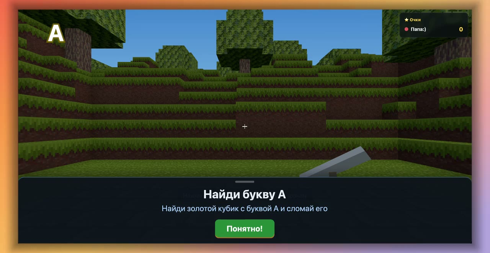

# Мой безопасный город

Многопользовательская игра в духе voxel-песочницы для детей от 4 лет. Ребёнок строит свой город: ставит маяки, сирены и датчики, а ещё ищет спрятанные золотые кубики с буквами русского алфавита.

https://github.com/makslanies/kids-minecraft

[](assets/game-mc.mp4)

[Смотреть видео](assets/game-mc.mp4) · [видео в issue](https://github.com/makslanies/kids-minecraft/issues/1)

## Для родителей

- В игре нет боя, чата и чужих игроков. Животные не получают урона.
- Игроки видят друг друга в одном мире, до 8 человек.
- Вход на публичный сайт защищён паролем.
- Играть можно на компьютере с клавиатурой и мышью, а на планшете и телефоне — с экранными кнопками.

## Управление

| Клавиша | Действие |
| --- | --- |
| W A S D | ходить |
| Space | прыжок |
| Shift | бежать |
| Левая кнопка мыши | сломать блок |
| Правая кнопка мыши | поставить блок |
| Esc | выйти из игры |

На планшете и телефоне стрелки слева внизу, круг справа внизу — смотреть по сторонам, кнопки посередине — сломать, поставить и прыгнуть.

## Как устроено

- **Сервер** (`server/`): Node.js и WebSocket (`ws`), авторитетный: сервер решает, что можно сломать и где стоит игрок. Мир генерируется из сида, изменения сохраняются в файл.
- **Клиент** (`src/`): three.js, собирается Vite. Сборка — это статический сайт, его можно ставить на любой хостинг.
- **Общий код** (`shared/`): блоки, миссии, районы, протокол — один и тот же код работает на сервере и в браузере.
- **Установка**: сайт можно добавить на главный экран планшета или телефона (PWA), в собранной версии работает офлайн-кэш.

## Запуск

Нужен Node.js 22 или новее.

```bash
npm install
npm run dev        # сервер на ws://localhost:8787, клиент на http://localhost:5173
```

Остановить: `Ctrl+C`.

Проверка:

```bash
npm test           # тесты сервера и клиентской логики
npx vite build     # сборка в dist/
```

### Переменные окружения сервера

| Переменная | По умолчанию | Что делает |
| --- | --- | --- |
| `PORT` | `8787` | порт WebSocket |
| `HOST` | `0.0.0.0` | адрес, на котором слушает сервер |
| `GAME_DATA_DIR` | `server/data` | где хранится сохранение мира |
| `VITE_SERVER_URL` | `ws://<адрес сайта>:8787` | адрес сервера, который вшивается в сборку клиента, например `wss://example.com/ws` |

Адрес можно также передать в строке браузера: `?server=wss://...`.

## Тесты и проверки

- `test/` — тесты сервера, мира, мобов, миссий и протокола, а также интеграционные тесты с настоящим сервером.
- `tools/build-atlas.py` — собирает атлас текстур из `assets/textures/source/`.

## Лицензия и авторство

- Код: MIT, см. [LICENSE](LICENSE). Основа проекта — [HunterXing/voxel-multiplayer](https://github.com/HunterXing/voxel-multiplayer) (MIT).
- Текстуры блоков: CC0, см. [assets/textures/LICENSE.md](assets/textures/LICENSE.md).
- Разработчик: Максим Ланиес. Вопросы, доработки и идеи: [Telegram t.me/ilanies](https://t.me/ilanies) или [MAX](https://max.ru/u/f9LHodD0cOIbCxeh8UeKTgIyMK4OG8Hr_u-b4Sakn4oJBrUrIjOt4M6u-mg).
